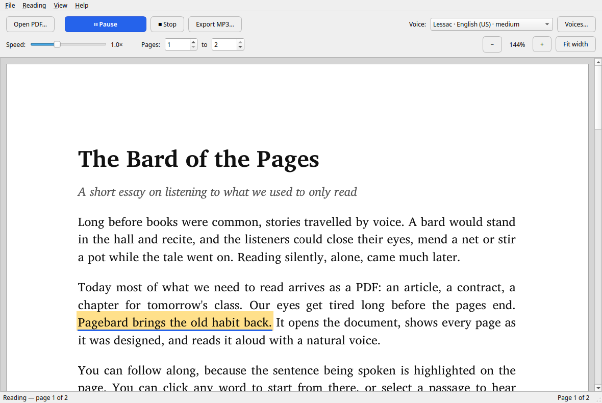

<div align="center">


# Pagebard

**Escuche sus PDF.**<br>
Una aplicación para Linux que lee documentos en voz alta con voces naturales — sin internet, en su propio equipo.

[](https://github.com/GabrielRochaFC/pagebard/actions/workflows/ci.yml)
[](https://github.com/GabrielRochaFC/pagebard/releases/latest)
[](LICENSE)

[English](README.md) · [Português](README.pt-BR.md) · **Español**



</div>

## Por qué Pagebard

Artículos, contratos, apuntes de clase: casi todo lo que tenemos que leer llega
en PDF, y la vista se cansa mucho antes de que se acaben las páginas. Pagebard
abre el documento, muestra cada página tal como fue diseñada y se la lee — como
un bardo que recita la página.

Sin cuenta, sin nube, sin tarjeta gráfica. Las voces funcionan en el procesador,
y nada de lo que abre sale de su equipo.

## Características

- 📄 **Páginas reales** — el PDF se muestra tal como es, no como texto extraído.
- 🔦 **Siga la lectura** — la frase que se pronuncia se resalta en la página, y la vista se desplaza con ella.
- 🖱️ **Empiece donde quiera** — haga clic en una palabra para empezar allí, doble clic para leer de inmediato, o arrastre para seleccionar un fragmento y oír solo eso.
- 🗣️ **Voces naturales sin conexión** — voces neuronales de [Piper](https://github.com/OHF-Voice/piper1-gpl) en decenas de idiomas, descargadas bajo demanda.
- ⏩ **A su ritmo** — de 0,5× a 2,0×, sin cambiar el tono de la voz.
- 🎧 **Exportar a MP3** — convierta el documento, o un intervalo de páginas, en un archivo de audio.
- 🔎 **También PDF escaneados** — reconocimiento de texto (OCR) integrado para documentos que son solo imagen.
- ⌨️ **Todo con el teclado** — cada orden tiene atajo y entrada de menú; el texto de la interfaz se puede ampliar.
- 🌍 **Tres idiomas de interfaz** — English, Português (Brasil) y Español.

## Instalar

Pagebard se distribuye como un único archivo Flatpak.

1. Descargue **[Pagebard.flatpak](https://github.com/GabrielRochaFC/pagebard/releases/latest/download/Pagebard.flatpak)** de la última versión.
2. Haga doble clic en el archivo. Se abre el centro de software: elija **Instalar**.
3. Abra **Pagebard** desde el menú de aplicaciones.

La primera vez que pulse Reproducir, Pagebard ofrece descargar una voz (unos
60 MB). Después funciona sin internet.

<details>
<summary>Si el doble clic no abre el centro de software</summary>

El sistema necesita Flatpak. Fedora, Linux Mint, Pop!_OS y muchos otros lo
traen; en Ubuntu instálelo una sola vez:

```bash
sudo apt install flatpak gnome-software-plugin-flatpak
```

También puede instalar desde una terminal:

```bash
flatpak install --user Pagebard.flatpak
```

</details>

## Cómo se usa

1. **Abrir PDF…** — o arrastre el archivo a la ventana.
2. Pulse **Reproducir**. La frase actual se resalta en la página.
3. Elija qué escuchar:
   - **clic** en una palabra para empezar desde allí (durante la lectura, Pagebard salta a ese punto);
   - **doble clic** para empezar a leer de inmediato;
   - **arrastre** sobre el texto para leer solo ese fragmento;
   - o limite la lectura con los campos **Páginas**.

| Tecla | Acción |
|---|---|
| <kbd>Ctrl</kbd>+<kbd>O</kbd> | Abrir un PDF |
| <kbd>Espacio</kbd> | Reproducir / pausar / continuar |
| <kbd>Esc</kbd> | Detener; detenido, borra la selección y el punto de inicio |
| <kbd>+</kbd> / <kbd>-</kbd> | Lectura más rápida / más lenta |
| <kbd>Ctrl</kbd>+<kbd>E</kbd> | Exportar a MP3 |
| <kbd>Ctrl</kbd>+<kbd>+</kbd> / <kbd>Ctrl</kbd>+<kbd>-</kbd> / <kbd>Ctrl</kbd>+<kbd>0</kbd> | Ampliar / reducir / ajustar al ancho |
| <kbd>Ctrl</kbd>+<kbd>C</kbd> | Copiar el fragmento seleccionado |
| <kbd>F1</kbd> | Lista completa de atajos |

**Voces.** *Voces…* muestra todo lo disponible en la
[colección de voces de Piper](https://huggingface.co/rhasspy/piper-voices);
descargue las que quiera y quite las que no use.

**Documentos escaneados.** Cuando un PDF no tiene texto, Pagebard ofrece
reconocerlo. El resultado se lee y se resalta como cualquier otro documento.

**Idioma.** La interfaz sigue el idioma del sistema; cámbielo en *Ver → Idioma*.

## Privacidad

Pagebard nunca sube sus documentos. La red solo se usa cuando *usted* pide una
descarga: una voz, la lista de voces o los datos de reconocimiento de texto.

## Compilar desde el código

```bash
git clone https://github.com/GabrielRochaFC/pagebard.git
cd pagebard
python3 -m venv .venv
.venv/bin/python -m pip install -e ".[dev]"
.venv/bin/python -m pagebard          # ejecutar
.venv/bin/python -m pytest            # probar
```

Requiere Python 3.11 o posterior. Para exportar a MP3 hace falta `ffmpeg`.

Para generar el paquete Flatpak (necesita `flatpak` y `flatpak-builder`):

```bash
packaging/flatpak/build.sh
```

## Contribuir

Los informes de errores, ideas y traducciones son bienvenidos — vea
[CONTRIBUTING.md](CONTRIBUTING.md) (en inglés). Añadir un idioma es un solo
archivo de texto.

Limitaciones conocidas: los encabezados y pies de página repetidos se leen, una
frase que cruza un salto de página se lee en dos partes, y solo se admite Linux.

## Créditos

Pagebard se apoya en [Piper](https://github.com/OHF-Voice/piper1-gpl) (voz),
[PyMuPDF](https://pymupdf.readthedocs.io/) / MuPDF y Tesseract (PDF y OCR),
[Qt for Python](https://doc.qt.io/qtforpython/) (interfaz) y
[FFmpeg](https://ffmpeg.org/) (MP3).

### Cómo se hizo este proyecto

Pagebard se escribió con una fuerte ayuda de IA: la mayor parte del código, las
pruebas y la documentación fue producida por
[Claude](https://claude.com/claude-code), bajo la dirección y las pruebas
prácticas del mantenedor. Todo el comportamiento está cubierto por la batería de
pruebas automáticas. Se agradecen especialmente la revisión humana, las
correcciones de las traducciones y los informes de errores.

## Licencia

[AGPL-3.0-or-later](LICENSE). Pagebard es software libre: puede usarlo,
estudiarlo, compartirlo y mejorarlo.
