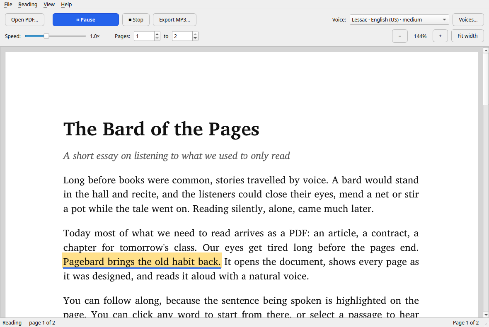
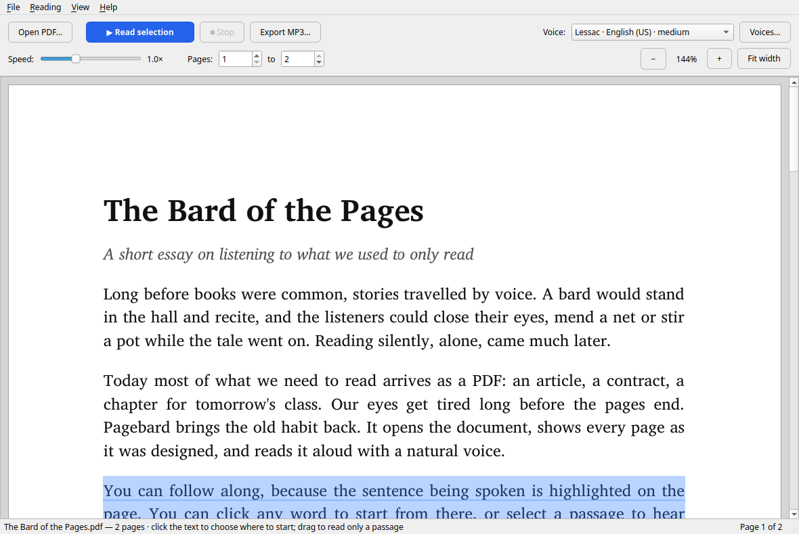
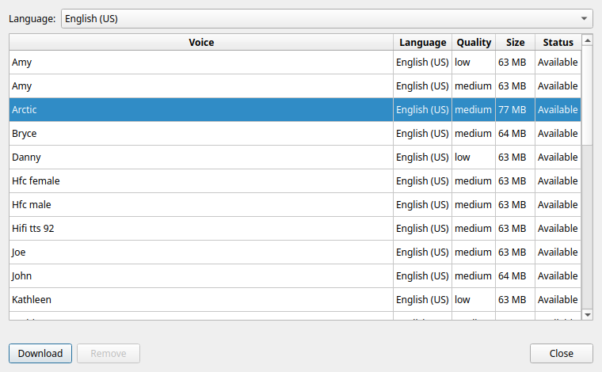

<div align="center">


# Pagebard

**Listen to your PDFs.**<br>
A Linux desktop app that reads documents aloud with natural voices — offline, on your own computer.

[](https://github.com/GabrielRochaFC/pagebard/actions/workflows/ci.yml)
[](https://github.com/GabrielRochaFC/pagebard/releases/latest)
[](LICENSE)


**English** · [Português](README.pt-BR.md) · [Español](README.es.md)



</div>

## Why Pagebard

Articles, contracts, class notes: most of what we have to read arrives as a PDF,
and our eyes get tired long before the pages end. Pagebard opens the document,
shows every page exactly as it was designed, and reads it to you — like a bard
reciting from the page.

No account, no cloud, no graphics card. The voices run on your CPU, and nothing
you open ever leaves your computer.

## Features

- 📄 **Real pages** — the PDF is displayed as it is, not as extracted text.
- 🔦 **Follow along** — the sentence being spoken is highlighted on the page, and the view scrolls with it.
- 🖱️ **Start anywhere** — click a word to begin there, double-click to start at once, or drag to select a passage and hear only that.
- 🗣️ **Natural offline voices** — [Piper](https://github.com/OHF-Voice/piper1-gpl) neural voices in dozens of languages, downloaded on demand.
- ⏩ **Your pace** — from 0.5× to 2.0×, without changing the pitch.
- 🎧 **Export to MP3** — turn a document, or a range of pages, into an audio file.
- 🔎 **Scanned PDFs too** — built-in text recognition (OCR) for documents that are only pictures.
- ⌨️ **Keyboard friendly** — every command has a shortcut and a menu entry; the interface text can be enlarged.
- 🌍 **Three interface languages** — English, Português (Brasil) and Español.

## Screenshots

| Select a passage to hear only that | Voices in many languages |
|---|---|
|  |  |

## Install

Pagebard is distributed as a single Flatpak file.

1. Download **[Pagebard.flatpak](https://github.com/GabrielRochaFC/pagebard/releases/latest/download/Pagebard.flatpak)** from the latest release.
2. Double-click the file. Your software centre opens: choose **Install**.
3. Open **Pagebard** from the applications menu.

The first time you press Play, Pagebard offers to download a voice (about 60 MB).
After that it works without internet.

<details>
<summary>If double-clicking does not open the software centre</summary>

Your system needs Flatpak. Fedora, Linux Mint, Pop!_OS and many others ship it;
on Ubuntu install it once with:

```bash
sudo apt install flatpak gnome-software-plugin-flatpak
```

You can also install from a terminal:

```bash
flatpak install --user Pagebard.flatpak
```

</details>

## Using it

1. **Open PDF…** — or drag a file onto the window.
2. Press **Play**. The current sentence lights up on the page.
3. Choose what to hear:
   - **click** a word to start from there (while reading, Pagebard jumps to it);
   - **double-click** to start reading at once;
   - **drag** over the text to read only that passage;
   - or limit the reading with the **Pages** fields.

| Key | Action |
|---|---|
| <kbd>Ctrl</kbd>+<kbd>O</kbd> | Open a PDF |
| <kbd>Space</kbd> | Play / pause / resume |
| <kbd>Esc</kbd> | Stop; when stopped, clears the selection and the starting point |
| <kbd>+</kbd> / <kbd>-</kbd> | Read faster / slower |
| <kbd>Ctrl</kbd>+<kbd>E</kbd> | Export to MP3 |
| <kbd>Ctrl</kbd>+<kbd>+</kbd> / <kbd>Ctrl</kbd>+<kbd>-</kbd> / <kbd>Ctrl</kbd>+<kbd>0</kbd> | Zoom in / zoom out / fit width |
| <kbd>Ctrl</kbd>+<kbd>C</kbd> | Copy the selected passage |
| <kbd>F1</kbd> | Full list of shortcuts |

**Voices.** *Voices…* lists everything available from the
[Piper voice collection](https://huggingface.co/rhasspy/piper-voices); download
the ones you want and remove those you do not use.

**Scanned documents.** When a PDF has no text, Pagebard offers to recognise it.
The result is read and highlighted like any other document.

**Language.** The interface follows your system language; change it in
*View → Language*.

## Privacy

Pagebard never uploads your documents. The network is used only when *you* ask
for a download: a voice, the voice list, or text-recognition data.

## Build from source

```bash
git clone https://github.com/GabrielRochaFC/pagebard.git
cd pagebard
python3 -m venv .venv
.venv/bin/python -m pip install -e ".[dev]"
.venv/bin/python -m pagebard          # run
.venv/bin/python -m pytest            # test
```

Requires Python 3.11 or newer. MP3 export needs `ffmpeg` on your `PATH`.

To build the Flatpak bundle yourself (needs `flatpak` and `flatpak-builder`):

```bash
packaging/flatpak/build.sh
```

## How it works

| Part | Role |
|---|---|
| `pagebard/core` | PDF text with word positions, sentence splitting, voices, speech synthesis, MP3 export, OCR. No user interface code. |
| `pagebard/playback` | Synthesises a few sentences ahead on a thread and feeds the sound device. |
| `pagebard/ui` | The window: page view, highlights, selection, dialogs. |

Heavy PDF work (drawing pages, OCR) runs in a child process so the window never
freezes. More in [docs/ARCHITECTURE.md](docs/ARCHITECTURE.md).

## Contributing

Bug reports, ideas and translations are welcome — see
[CONTRIBUTING.md](CONTRIBUTING.md). Adding a language is a single text file.

Known limitations: repeated page headers and footers are read aloud, a sentence
that crosses a page break is read in two parts, and only Linux is supported.

## Credits

Pagebard stands on the shoulders of
[Piper](https://github.com/OHF-Voice/piper1-gpl) (speech),
[PyMuPDF](https://pymupdf.readthedocs.io/) / MuPDF and Tesseract (PDF and OCR),
[Qt for Python](https://doc.qt.io/qtforpython/) (interface) and
[FFmpeg](https://ffmpeg.org/) (MP3).

### How this project was made

Pagebard was written with heavy AI assistance: most of the code, tests and
documentation were produced by [Claude](https://claude.com/claude-code) under
the direction and hands-on testing of the maintainer. Every behaviour is
covered by the automated test suite. Human review, corrections to the
translations and bug reports are especially appreciated.

## License

[AGPL-3.0-or-later](LICENSE). Pagebard is free software: you may use, study,
share and improve it.
