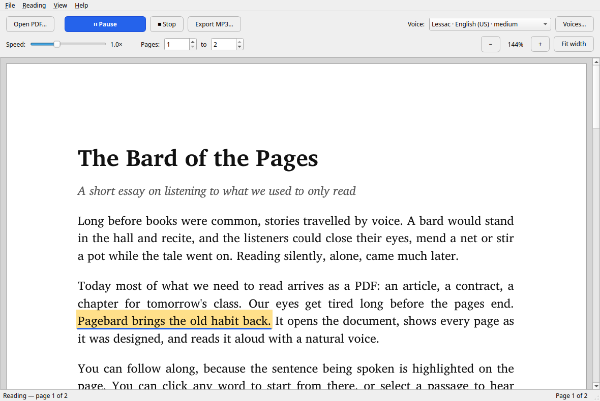

<div align="center">


# Pagebard

**Ouça seus PDFs.**<br>
Um aplicativo para Linux que lê documentos em voz alta com vozes naturais — sem internet, no seu próprio computador.

[](https://github.com/GabrielRochaFC/pagebard/actions/workflows/ci.yml)
[](https://github.com/GabrielRochaFC/pagebard/releases/latest)
[](LICENSE)

[English](README.md) · **Português** · [Español](README.es.md)



</div>

## Por que o Pagebard

Artigos, contratos, anotações de aula: quase tudo que precisamos ler chega em
PDF, e os olhos cansam muito antes de as páginas acabarem. O Pagebard abre o
documento, mostra cada página como ela foi feita e lê para você — como um bardo
recitando a página.

Sem conta, sem nuvem, sem placa de vídeo. As vozes rodam no processador, e nada
do que você abre sai do seu computador.

## Recursos

- 📄 **Páginas de verdade** — o PDF aparece como ele é, não como texto extraído.
- 🔦 **Acompanhe a leitura** — a frase falada fica destacada na página, e a tela rola junto.
- 🖱️ **Comece de onde quiser** — clique numa palavra para começar dali, dê duplo clique para ler na hora, ou arraste para selecionar um trecho e ouvir só ele.
- 🗣️ **Vozes naturais e offline** — vozes neurais do [Piper](https://github.com/OHF-Voice/piper1-gpl) em dezenas de idiomas, baixadas sob demanda.
- ⏩ **No seu ritmo** — de 0,5× a 2,0×, sem mudar o tom da voz.
- 🎧 **Exportar para MP3** — transforme o documento, ou um intervalo de páginas, em um arquivo de áudio.
- 🔎 **PDFs escaneados também** — reconhecimento de texto (OCR) embutido para documentos que são só imagem.
- ⌨️ **Tudo pelo teclado** — cada comando tem atalho e item de menu; o texto da interface pode ser ampliado.
- 🌍 **Três idiomas na interface** — English, Português (Brasil) e Español.

## Instalar

O Pagebard é distribuído como um único arquivo Flatpak.

1. Baixe o **[Pagebard.flatpak](https://github.com/GabrielRochaFC/pagebard/releases/latest/download/Pagebard.flatpak)** da versão mais recente.
2. Dê dois cliques no arquivo. A loja de aplicativos abre: escolha **Instalar**.
3. Abra o **Pagebard** pelo menu de aplicativos.

Na primeira vez que você apertar Reproduzir, o Pagebard oferece baixar uma voz
(cerca de 60 MB). Depois disso funciona sem internet.

<details>
<summary>Se o duplo clique não abrir a loja</summary>

O sistema precisa do Flatpak. Fedora, Linux Mint, Pop!_OS e muitos outros já
vêm com ele; no Ubuntu, instale uma única vez:

```bash
sudo apt install flatpak gnome-software-plugin-flatpak
```

Também dá para instalar pelo terminal:

```bash
flatpak install --user Pagebard.flatpak
```

</details>

## Como usar

1. **Abrir PDF…** — ou arraste o arquivo para a janela.
2. Aperte **Reproduzir**. A frase atual fica destacada na página.
3. Escolha o que ouvir:
   - **clique** numa palavra para começar dali (durante a leitura, o Pagebard pula para lá);
   - **duplo clique** começa a ler na hora;
   - **arraste** sobre o texto para ler só aquele trecho;
   - ou limite a leitura nos campos **Páginas**.

| Tecla | O que faz |
|---|---|
| <kbd>Ctrl</kbd>+<kbd>O</kbd> | Abrir um PDF |
| <kbd>Espaço</kbd> | Reproduzir / pausar / continuar |
| <kbd>Esc</kbd> | Parar; com a leitura parada, limpa a seleção e o ponto de início |
| <kbd>+</kbd> / <kbd>-</kbd> | Leitura mais rápida / mais devagar |
| <kbd>Ctrl</kbd>+<kbd>E</kbd> | Exportar para MP3 |
| <kbd>Ctrl</kbd>+<kbd>+</kbd> / <kbd>Ctrl</kbd>+<kbd>-</kbd> / <kbd>Ctrl</kbd>+<kbd>0</kbd> | Aumentar / diminuir / ajustar à largura |
| <kbd>Ctrl</kbd>+<kbd>C</kbd> | Copiar o trecho selecionado |
| <kbd>F1</kbd> | Lista completa de atalhos |

**Vozes.** *Vozes…* mostra tudo o que existe na
[coleção de vozes do Piper](https://huggingface.co/rhasspy/piper-voices); baixe
as que quiser e remova as que não usa.

**Documentos escaneados.** Quando o PDF não tem texto, o Pagebard oferece
reconhecê-lo. O resultado é lido e destacado como em qualquer documento.

**Idioma.** A interface segue o idioma do sistema; troque em *Exibir → Idioma*.

## Privacidade

O Pagebard nunca envia seus documentos para lugar nenhum. A rede só é usada
quando *você* pede um download: uma voz, a lista de vozes ou os dados de
reconhecimento de texto.

## Compilar a partir do código

```bash
git clone https://github.com/GabrielRochaFC/pagebard.git
cd pagebard
python3 -m venv .venv
.venv/bin/python -m pip install -e ".[dev]"
.venv/bin/python -m pagebard          # rodar
.venv/bin/python -m pytest            # testar
```

Requer Python 3.11 ou mais novo. Para exportar MP3 é preciso ter o `ffmpeg`.

Para gerar o pacote Flatpak (precisa de `flatpak` e `flatpak-builder`):

```bash
packaging/flatpak/build.sh
```

## Contribuir

Relatos de erro, ideias e traduções são bem-vindos — veja o
[CONTRIBUTING.md](CONTRIBUTING.md) (em inglês). Acrescentar um idioma é um único
arquivo de texto.

Limitações conhecidas: cabeçalhos e rodapés repetidos são lidos, uma frase que
atravessa a quebra de página é lida em duas partes, e só o Linux é suportado.

## Créditos

O Pagebard se apoia no [Piper](https://github.com/OHF-Voice/piper1-gpl) (fala),
no [PyMuPDF](https://pymupdf.readthedocs.io/) / MuPDF e Tesseract (PDF e OCR),
no [Qt for Python](https://doc.qt.io/qtforpython/) (interface) e no
[FFmpeg](https://ffmpeg.org/) (MP3).

### Como este projeto foi feito

O Pagebard foi escrito com forte auxílio de IA: a maior parte do código, dos
testes e da documentação foi produzida pelo
[Claude](https://claude.com/claude-code), sob a direção e os testes práticos do
mantenedor. Todo comportamento é coberto pela suíte de testes automatizados.
Revisão humana, correções nas traduções e relatos de erro são muito bem-vindos.

## Licença

[AGPL-3.0-or-later](LICENSE). O Pagebard é software livre: você pode usar,
estudar, compartilhar e melhorar.
